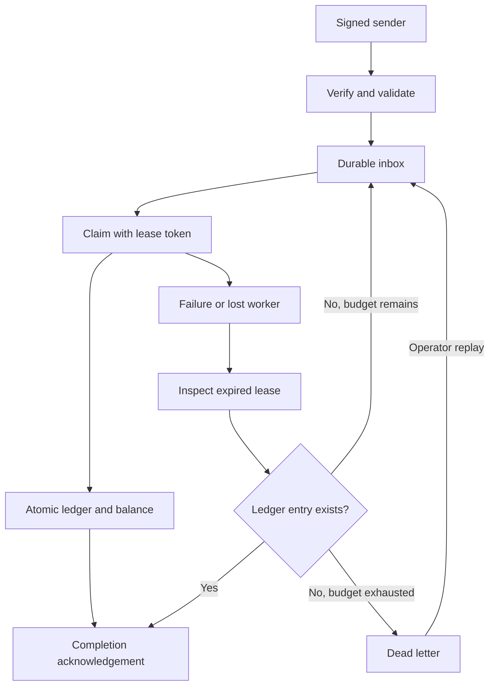

# Webhook Recovery Lab

A durable webhook inbox that makes duplicate delivery, retries, and crash recovery visible. Built by **Dinesh Kumar Rama** with Java 21, Spring Boot, PostgreSQL, Flyway, and a dependency-free dashboard.

**The contract:** acknowledge accepted work only after persistence; apply at most one PostgreSQL credit effect for each event ID; recover unfinished processing from a durable lease.

This project uses synthetic credits. The hosted portfolio companion is explicitly a **browser simulation**. It shares the dashboard and demonstrates state transitions using local storage; it does not run Java or prove database concurrency. The service and integration tests in this repository use real PostgreSQL.

## Run the complete backend

Prerequisite: Docker Desktop with Compose.

```bash
cp .env.example .env
docker compose up --build
```

Open **http://localhost:8080**, then enter the `ADMIN_TOKEN` from `.env`. The default local demonstration token is `local-admin-token-change-before-hosting`. All operator API calls and Prometheus metrics require this token. Compose binds the app to localhost and keeps PostgreSQL on the private Compose network.

The **Failure lab** offers six scenarios: clean delivery, ten duplicate deliveries, two transient failures, a poison event, crash before the business commit, and crash after the commit. Open an event to compare its deliveries, attempts, audit trail, and ledger entry.

To stop, use `docker compose down`. The named database volume retains events across restarts.

## Run without Docker

Prerequisites: a **JDK 21** (not only a JRE), PostgreSQL, and Git. Maven Wrapper downloads Maven automatically; global Maven is optional.

Create a database and set its connection details:

```bash
export DATABASE_URL=jdbc:postgresql://localhost:5432/webhook_lab
export DATABASE_USER=webhook
export DATABASE_PASSWORD=webhook_local
export ADMIN_TOKEN=local-admin-token-change-before-hosting
export WEBHOOK_SECRET=local-webhook-secret-change-before-hosting
./mvnw spring-boot:run
```

On Windows use `mvnw.cmd` and the equivalent PowerShell environment variables. Flyway creates the schema at startup. A database role that can run migrations is required for this local project.

## Send a real signed webhook

The Python sender uses only the standard library. Its secret must match the backend's `WEBHOOK_SECRET`.

```bash
python3 scripts/send_event.py --id evt_demo_001 --copies 60 --concurrency 12
```

The response summary should show one accepted event and 59 duplicate acknowledgements. Once the worker runs, inspect `evt_demo_001`: delivery count 60, one ledger entry, ten credits. Reusing the ID with a different account or credit amount returns HTTP 409.

Signature format:

```text
X-Webhook-Timestamp: <Unix seconds>
X-Webhook-Signature: v1=<hex HMAC-SHA256(secret, timestamp + "." + original_request_bytes)>
```

Timestamps outside a five-minute window are rejected. Body size is capped at 16 KiB. JSON business fields are strictly validated; fractional credits and unknown fields are rejected. Payload identity is a SHA-256 hash of the validated ID, account ID, and integer credits, so whitespace and JSON key order do not produce false conflicts.

## Verify the reliability contracts

```bash
./mvnw verify
node --test scripts/simulation.test.mjs
npm run check
```

The Java tests start a real, temporary PostgreSQL process through Zonky Embedded Postgres. Docker is not required for tests. Run them as a regular user; PostgreSQL refuses to run as root. First execution needs internet access for Maven dependencies and the platform-specific PostgreSQL binary. Test databases are disposable and separate from your development database.

The suite checks concurrent duplicate acceptance, concurrent account updates, payload conflicts, signatures, timestamps, validation, request size, retry scheduling, exhaustion, replay, both transaction crash points, stale leases, append-only audit records, authenticated API access, and reopening the application against an existing database. GitHub Actions runs verification and uploads its reports.

For a separate **actual process termination** check, build the JAR, point environment variables at a local disposable development database, and use a free port:

```bash
./mvnw package
PORT=18080 python3 scripts/verify_process_restart.py
```

The script starts the app with automatic polling disabled, accepts an event, sends SIGKILL to the process it owns, restarts it against the same database, and processes the persisted event. It writes evidence under `test-results/`. It never kills an unrelated Java process. The subprocess SIGKILL demonstration is intended for Linux/macOS; the integration suite is the portable restart check.

See [verification evidence](docs/verification.md) for the checks run during this build and their limits.

## Architecture



There are four short transaction boundaries: inbox acceptance; work claiming; ledger plus balance update; and completion or recovery. `FOR UPDATE SKIP LOCKED` allows concurrent workers to claim separate ready rows. A lease token fences stale claims. The database checks lease expiry using its own clock.

The business transaction locks the event, verifies ownership, inserts a ledger record with unique `event_id`, and increments the account balance only if that insert succeeds. A crash before commit rolls back both writes. A crash after commit leaves proof in the ledger; recovery reconciles status without applying another credit.

This is **at-least-once processing with an idempotent database effect**, not exactly-once network delivery.

## Explore the source

| File | Responsibility |
| --- | --- |
| `LabController.java` | HTTP contract, strict event decoding, operator endpoints |
| `Signatures.java` | HMAC authentication and payload hashing |
| `RequestGuard.java` | Operator token, bounded request bodies, browser security headers |
| `Inbox.java` | Durable acceptance, conflict detection, replay, inspection |
| `QueueWorker.java` | Claims, retry policy, fenced business writes, lease reconciliation |
| `DemoScenarios.java` | Atomic creation and configuration of synthetic failure scenarios |
| `V1__durable_inbox.sql` | Constraints, indexes, ledger, attempt history, audit trigger |
| `src/main/resources/static/` | Dashboard and separately labelled browser simulation |
| `RecoveryIntegrationTest.java` | HTTP, database, concurrency, and failure contracts |
| `RestartRecoveryTest.java` | Application recreation with an existing PostgreSQL database |

## Operator API

See [API reference](docs/api.md). The dashboard uses the same API. Supply `X-Admin-Token` for every `/api/` operation; do not put tokens in query strings.

```bash
curl -H "X-Admin-Token: $ADMIN_TOKEN" http://localhost:8080/api/stats
curl -H "X-Admin-Token: $ADMIN_TOKEN" http://localhost:8080/actuator/prometheus
```

Metrics include `lab_processing_seconds`, `lab_processing_results_total`, `lab_lease_recoveries_total`, `lab_stale_claims_total`, and `lab_simulated_crashes_total`. Durable event totals and account balances come from `/api/stats`, not in-memory counters. Metric labels do not contain event IDs.

## Configuration

| Variable | Default | Purpose |
| --- | --- | --- |
| `DATABASE_URL` | `jdbc:postgresql://localhost:5432/webhook_lab` | JDBC connection |
| `DATABASE_USER` | `webhook` | Database role |
| `DATABASE_PASSWORD` | `webhook_local` | Local database password |
| `ADMIN_TOKEN` | Local demonstration value | Operator authentication; minimum 24 characters |
| `WEBHOOK_SECRET` | Local demonstration value | HMAC secret; minimum 24 characters |
| `WORKER_ENABLED` | `true` | Automatic polling on this instance |
| `WORKER_POLL_MS` | `750` | Delay between scheduled batches |
| `LEASE_SECONDS` | `15` | Claim lease duration |
| `RETRY_BASE_MS` | `2000` | Base exponential retry delay |
| `MAX_ATTEMPTS` | `5` | Attempt budget per replay cycle |
| `DEMO_ENABLED` | `true` | Enable authenticated failure injection |
| `PORT` | `8080` | HTTP port |

Backoff grows exponentially with up to 20% positive jitter, with the exponential component capped at 60 seconds. Lease expiry recovery checks the ledger before checking the retry budget. Replays reset only the retry-cycle counter; total attempt numbers, event identity, delivery count, and history remain intact.

## Scope and tradeoffs

- One service and one PostgreSQL database; no Kafka or Redis is needed for this bounded inbox.
- A shared operator token and one tenant. There is no user-account system or arbitrary outbound webhook forwarding.
- Pause/resume affects one service instance. Manual processing remains available while automatic polling is paused.
- Credit grants are short SQL transactions. Long external jobs would need lease renewal and a separate side-effect protocol.
- The append-only audit trigger prevents accidental updates/deletes through SQL; a privileged database administrator can alter the schema. It is not a tamper-proof compliance store.
- Database backups, high availability, public ingress, key rotation, and tenant quotas are deployment concerns outside version one. Replace local tokens and disable demo injection when hosting a non-demo backend.
- Initial build verification covers the JAR and PostgreSQL behavior. Container build verification is reported separately in the evidence file.

## Learn it in parallel

Start with [the reverse-engineering guide](docs/learning-guide.md), then [the failure runbook](docs/runbook.md). Each lesson traces a working request, predicts a failure, checks the evidence, and ends with a small extension to implement yourself.

## References

- [Spring Boot 3.5 requirements](https://docs.spring.io/spring-boot/3.5/system-requirements.html)
- [PostgreSQL locking and SKIP LOCKED](https://www.postgresql.org/docs/16/sql-select.html)
- [PostgreSQL transaction isolation](https://www.postgresql.org/docs/16/transaction-iso.html)
- [Zonky Embedded Postgres](https://github.com/zonkyio/embedded-postgres)
- [Stripe webhook delivery guidance](https://docs.stripe.com/webhooks)
